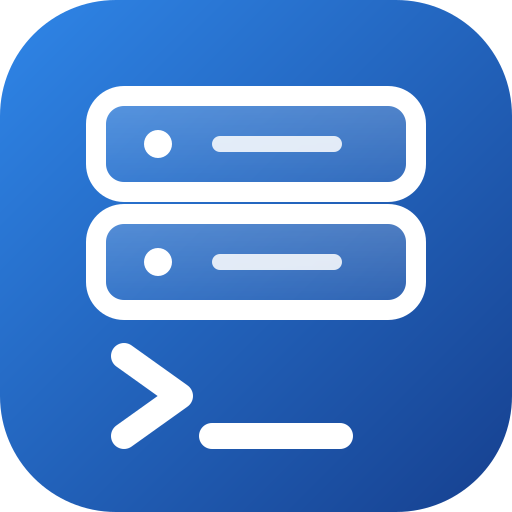
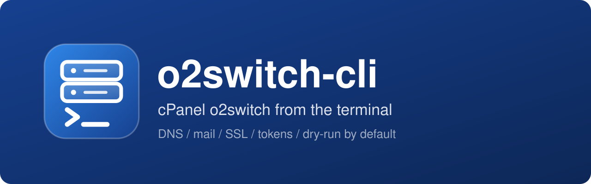
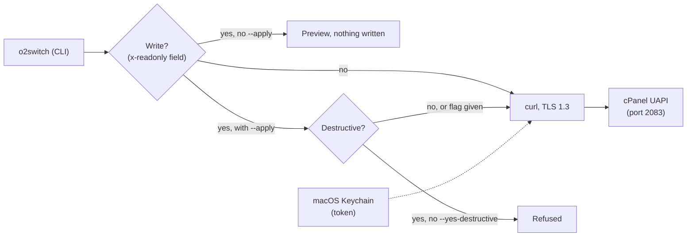

<div align="center">

[](README.md)



# o2switch-cli

**Drive your o2switch cPanel account from the terminal.**<br>
DNS, mail, SSL, tokens: everything goes through the UAPI. Every write shows what it will change first and does nothing without `--apply`.

[](LICENSE)
[](#requirements)
[](o2switch.py)
[](https://api.docs.cpanel.net)
[](#requirements)
[](AGENTS.md)

</div>

<p align="center"></p>

## Why

Managing an o2switch hosting account means clicking through cPanel for every DNS record, every forwarder, every certificate. And handing a whole account to a script or an AI agent is scary: one mistake in a DNS zone takes a site or your mail down.

`o2switch` puts the 693 functions of cPanel's UAPI on the command line, with guardrails: reads are free, every write is shown first and only runs with `--apply`, and deletions also need `--yes-destructive`. DNS writes are backed up before, then re-read and verified after.

## How it works



- **Read or write, decided by the spec.** `api-index.json` summarizes the 693 UAPI functions (summary, parameters, read-only flag) from cPanel's official spec. A function missing from it is treated as a write.
- **DNS is locked down.** Every write backs the zone up first, sends the SOA serial (refused if the zone moved in the meantime), then re-reads the zone and checks that only the targeted record changed. DNS and tokens have their own subcommands and never go through `call`.
- **The token stays out of reach.** It lives in the macOS Keychain (service `o2switch-cli.cpanel`) and never shows up in arguments, files or output. Requests are POSTs and never follow redirects.
- **`curl` for transport.** The system Python on macOS (LibreSSL 2.8) cannot speak TLS 1.3, which o2switch requires.

## Install

```sh
curl -fsSL https://raw.githubusercontent.com/pyxl-dev/o2switch-cli/main/install.sh | sh
```

The installer puts the code in `~/.local/share/o2switch-cli`, makes the `o2switch` command available in `~/.local/bin`, and checks that Python, `curl` and `dig` are present. Re-run it to update; `--uninstall` removes the command and the code. It only touches your home folder and leaves your configuration and token in place.

### Let your AI agent handle it

Paste this into Claude Code, Codex, Cursor or any agent with terminal access:

```text
Install and use o2switch-cli: https://github.com/pyxl-dev/o2switch-cli
Follow the AGENTS.md file in that repository.
```

[`AGENTS.md`](AGENTS.md) tells the agent how to install it, how to use it, and the safety rules (preview before writing, never a token in chat).

### Getting started

1. In cPanel: Security, then Manage API Tokens. Create a token with an expiry date.
2. Run `o2switch configure` and enter the hostname (`<server>.o2switch.net`, shown in cPanel), the cPanel user, the token name, then the token (hidden input).
3. `o2switch whoami` checks access.

After that, `o2switch token renew --apply` creates a new token (90 days by default), checks it, stores it in the Keychain and revokes the old one. A warning shows when expiry is close (7 days).

### Requirements

| | Used for |
| --- | --- |
| macOS | the Keychain, which holds the token (`security`) |
| Python 3.9 or newer | running the script (nothing to install) |
| `curl` | requests to cPanel over TLS 1.3 |
| `dig` | checking that a record is visible in public DNS after a write (optional) |
| An o2switch account and a cPanel API token | API access |

## Usage

```sh
o2switch dns list example.fr
o2switch dns list example.fr --type MX
o2switch dns set example.fr @ MX "10 mx1.example.net" --add            # preview
o2switch dns set example.fr @ TXT "v=spf1 ... ~all" --match v=spf1 --apply
o2switch dns set example.fr dkim._domainkey CNAME dkim._domainkey.example.net --apply
o2switch dns delete example.fr test TXT --apply --yes-destructive

o2switch mail list
o2switch mail forwarders example.fr
o2switch mail forward alias@example.fr me@example.fr --apply
o2switch mail catchall example.fr
o2switch mail catchall example.fr --set me@example.fr --apply

o2switch domains | ssl | db | quota

o2switch api search ssl autossl
o2switch api show Email add_pop
o2switch call SSL start_autossl_check --apply
o2switch call Email add_pop email=contact domain=example.fr password=@prompt --apply
```

| Command | What it does |
| --- | --- |
| `configure` | stores hostname, user and token (Keychain) |
| `whoami` | account and token expiry |
| `token list`, `token renew` | lists tokens, creates a new one and revokes the old one (`--days N`, `--keep-old`, `--apply`) |
| `dns list`, `dns backup`, `dns set`, `dns delete` | DNS zone (`--name`, `--type`, `--json`, `--out`, `--ttl`, `--add`, `--match`) |
| `mail list`, `forwarders`, `forward`, `catchall` | mailboxes, forwarders, catch-all |
| `domains`, `ssl`, `db`, `quota` | domains, installed certificates, MySQL databases, disk quota |
| `api search`, `api show` | browse the UAPI function index |
| `call MODULE FUNCTION key=value` | generic UAPI call |

- `call` parameters are written `key=value`, `key=@prompt` (hidden input) or `key=@file:path`.
- Supported DNS types: A, AAAA, CNAME, TXT, MX, SRV, CAA. SOA and NS are refused.
- When several records share the same name and type (TXT at the root), use `--match` to replace one or `--add` to add one.
- Zone backups go to `~/Library/Application Support/o2switch-cli/backups`.

### Limits

- Cron jobs only exist in cPanel's API2, so they are not handled yet.
- Real writes have not been retested against the server with this CLI yet (expired token). The formats come from the official spec and from an earlier script validated live in October 2026.

## Security

- Reads are free; writes need `--apply`; deletions (delete, remove, revoke, disable...) also need `--yes-destructive`.
- A function unknown to the index is treated as a write.
- The token never appears in process arguments, files or output.
- Parameters whose name suggests a secret (`pass`, `token`, `secret`, `key`, `hash`) are masked in previews. For a password, use `password=@prompt`.
- The configuration (hostname, user) lives in `~/Library/Application Support/o2switch-cli/config.json`, without the token.

## Development

```sh
git clone https://github.com/pyxl-dev/o2switch-cli && cd o2switch-cli
./install.sh                                   # installs this clone
python3 -m unittest discover -s tests -v       # no network, no token
python3 tools/build_index.py                   # rebuilds api-index.json from the official spec
```

| File | |
| --- | --- |
| `o2switch.py` | the command and all the code (no dependencies) |
| `api-index.json` | summary of the 693 UAPI functions: summary, parameters, read-only flag |
| `tools/build_index.py` | rebuilds the index from cPanel's OpenAPI spec |
| `tests/test_o2switch.py` | unit tests |
| `AGENTS.md` | instructions for any AI agent |
| `install.sh` | installer |

## License

[MIT](LICENSE)
