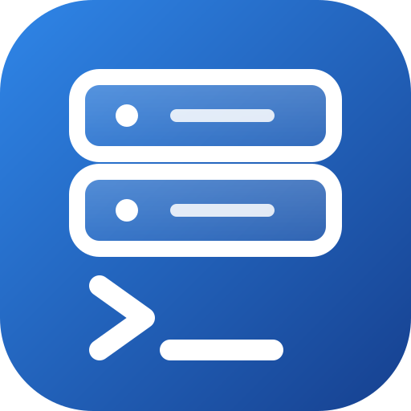
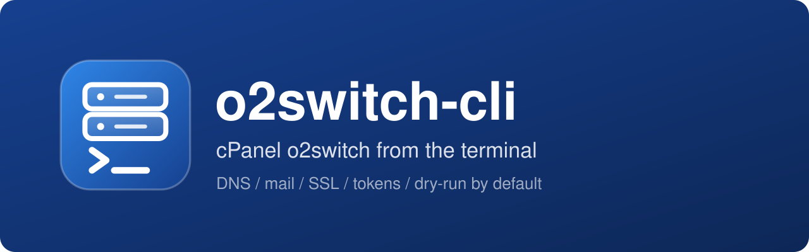
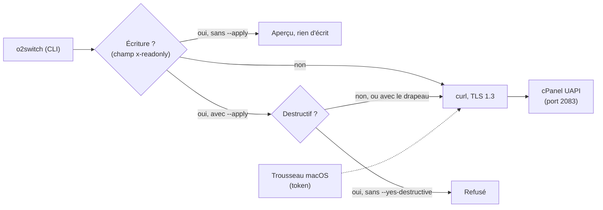

<div align="center">

[](README.en.md)



# o2switch-cli

**Pilote ton compte cPanel o2switch depuis le terminal.**<br>
DNS, mails, SSL, tokens : tout passe par l'API UAPI. Chaque écriture montre d'abord ce qu'elle va changer et ne fait rien sans `--apply`.

[](LICENSE)
[](#prérequis)
[](o2switch.py)
[](https://api.docs.cpanel.net)
[](#prérequis)
[](AGENTS.md)

</div>

<p align="center"></p>

## Pourquoi

Gérer un hébergement o2switch, c'est cliquer dans cPanel pour chaque record DNS, chaque redirection, chaque certificat. Et confier un compte entier à un script ou à un agent IA fait peur : une erreur sur une zone DNS coupe un site ou le courrier.

`o2switch` met les 693 fonctions de l'API UAPI de cPanel en ligne de commande, avec des garde-fous : la lecture est libre, toute écriture s'affiche d'abord et n'est exécutée qu'avec `--apply`, les suppressions demandent en plus `--yes-destructive`. Les écritures DNS sont sauvegardées avant, puis relues et vérifiées après.

## Comment ça marche



- **Lecture ou écriture, décidé par la spec.** `api-index.json` résume les 693 fonctions UAPI (résumé, paramètres, lecture seule) à partir de la spec officielle de cPanel. Une fonction qui n'y figure pas est traitée comme une écriture.
- **Le DNS est blindé.** Chaque écriture sauvegarde la zone avant, envoie le serial SOA (refus si la zone a bougé entre-temps), puis relit la zone et vérifie que seul le record visé a changé. Le DNS et les tokens ont leurs sous-commandes, ils ne passent jamais par `call`.
- **Le token reste hors de portée.** Il vit dans le Trousseau macOS (service `o2switch-cli.cpanel`) et n'apparaît jamais dans les arguments, les fichiers ou la sortie. Les requêtes partent en POST, sans suivre de redirection.
- **`curl` pour le transport.** Le Python système de macOS (LibreSSL 2.8) ne gère pas TLS 1.3, que o2switch exige.

## Installation

```sh
curl -fsSL https://raw.githubusercontent.com/pyxl-dev/o2switch-cli/main/install.sh | sh
```

L'installateur met le code dans `~/.local/share/o2switch-cli`, rend la commande `o2switch` disponible dans `~/.local/bin` et vérifie que Python, `curl` et `dig` sont là. Relance-le pour mettre à jour ; `--uninstall` enlève la commande et le code. Il ne touche qu'à ton dossier perso, et laisse ta configuration et ton token en place.

### Laisse ton agent IA s'en occuper

Colle ceci dans Claude Code, Codex, Cursor ou n'importe quel agent qui a accès à un terminal :

```text
Installe et utilise o2switch-cli : https://github.com/pyxl-dev/o2switch-cli
Suis le fichier AGENTS.md de ce dépôt.
```

[`AGENTS.md`](AGENTS.md) explique à l'agent comment l'installer, comment s'en servir, et les règles de sécurité (aperçu avant écriture, jamais de token dans le chat). Il est en anglais, la langue que tous les agents lisent.

### Mise en route

1. Dans cPanel : Sécurité, puis Manage API Tokens. Crée un token avec une expiration.
2. Lance `o2switch configure` et saisis le hostname (`<serveur>.o2switch.net`, visible dans cPanel), l'identifiant cPanel, le nom du token, puis le token en saisie masquée.
3. `o2switch whoami` vérifie l'accès.

Ensuite, `o2switch token renew --apply` crée un nouveau token (90 jours par défaut), le vérifie, le range dans le Trousseau et révoque l'ancien. Un avertissement s'affiche quand l'expiration approche (7 jours).

### Prérequis

| | Sert à |
| --- | --- |
| macOS | le Trousseau, qui garde le token (`security`) |
| Python 3.9 ou plus récent | lancer le script (aucune dépendance à installer) |
| `curl` | les requêtes vers cPanel en TLS 1.3 |
| `dig` | vérifier la visibilité d'un record dans le DNS public après une écriture (facultatif) |
| Un compte o2switch et un token API cPanel | l'accès à l'API |

## Utilisation

```sh
o2switch dns list example.fr
o2switch dns list example.fr --type MX
o2switch dns set example.fr @ MX "10 mx1.example.net" --add            # aperçu
o2switch dns set example.fr @ TXT "v=spf1 ... ~all" --match v=spf1 --apply
o2switch dns set example.fr dkim._domainkey CNAME dkim._domainkey.example.net --apply
o2switch dns delete example.fr test TXT --apply --yes-destructive

o2switch mail list
o2switch mail forwarders example.fr
o2switch mail forward alias@example.fr moi@example.fr --apply
o2switch mail catchall example.fr
o2switch mail catchall example.fr --set moi@example.fr --apply

o2switch domains | ssl | db | quota

o2switch api search ssl autossl
o2switch api show Email add_pop
o2switch call SSL start_autossl_check --apply
o2switch call Email add_pop email=contact domain=example.fr password=@prompt --apply
```

| Commande | Rôle |
| --- | --- |
| `configure` | enregistre hostname, identifiant et token (Trousseau) |
| `whoami` | compte et expiration du token |
| `token list`, `token renew` | liste les tokens, en crée un nouveau et révoque l'ancien (`--days N`, `--keep-old`, `--apply`) |
| `dns list`, `dns backup`, `dns set`, `dns delete` | zone DNS (`--name`, `--type`, `--json`, `--out`, `--ttl`, `--add`, `--match`) |
| `mail list`, `forwarders`, `forward`, `catchall` | boîtes, redirections, catch-all |
| `domains`, `ssl`, `db`, `quota` | domaines, certificats installés, bases MySQL, quota disque |
| `api search`, `api show` | explorer l'index des fonctions UAPI |
| `call MODULE FONCTION clé=valeur` | appel UAPI générique |

- Les paramètres de `call` s'écrivent `clé=valeur`, `clé=@prompt` (saisie masquée) ou `clé=@file:chemin`.
- Types DNS gérés : A, AAAA, CNAME, TXT, MX, SRV, CAA. SOA et NS sont refusés.
- Quand plusieurs records partagent le même nom et le même type (TXT à la racine), il faut `--match` pour en remplacer un ou `--add` pour en ajouter un.
- Les sauvegardes de zone vont dans `~/Library/Application Support/o2switch-cli/backups`.

### Limites

- Les tâches cron n'existent qu'en API2 côté cPanel, pas encore gérées.
- Les écritures réelles n'ont pas encore été retestées sur le serveur avec cette CLI (token expiré). Les formats viennent de la spec officielle et d'un ancien script, validé en réel en octobre 2026.

## Sécurité

- Lecture libre ; écriture seulement avec `--apply` ; suppression (delete, remove, revoke, disable...) seulement avec `--yes-destructive` en plus.
- Une fonction inconnue de l'index est traitée comme une écriture.
- Le token n'apparaît jamais dans les arguments du processus, les fichiers ou la sortie.
- Les paramètres dont le nom évoque un secret (`pass`, `token`, `secret`, `key`, `hash`) sont masqués dans les aperçus. Pour un mot de passe, utilise `password=@prompt`.
- La configuration (hostname, identifiant) est dans `~/Library/Application Support/o2switch-cli/config.json`, sans le token.

## Développement

```sh
git clone https://github.com/pyxl-dev/o2switch-cli && cd o2switch-cli
./install.sh                                   # installe ce clone
python3 -m unittest discover -s tests -v       # sans réseau ni token
python3 tools/build_index.py                   # régénère api-index.json depuis la spec officielle
```

| Fichier | |
| --- | --- |
| `o2switch.py` | la commande et tout le code (aucune dépendance) |
| `api-index.json` | résumé des 693 fonctions UAPI : résumé, paramètres, lecture seule |
| `tools/build_index.py` | régénère l'index depuis la spec OpenAPI de cPanel |
| `tests/test_o2switch.py` | tests unitaires |
| `AGENTS.md` | instructions pour n'importe quel agent IA |
| `install.sh` | installateur |

## Licence

[MIT](LICENSE)
